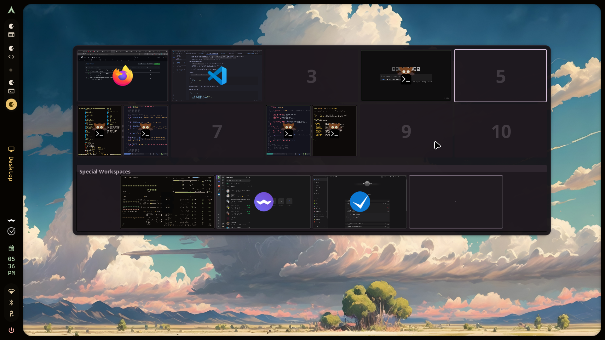

# Caelestia Overview

A Hyprland workspace overview for Quickshell, tuned for the [Caelestia](https://github.com/caelestia-dots) shell setup. Shows all workspaces with live window previews, drag-and-drop, special-workspace row, layered transparency, and Roman-numeral special-workspace numbering.

Forked from [Shanu-Kumawat/quickshell-overview](https://github.com/Shanu-Kumawat/quickshell-overview), itself extracted from [end-4/dots-hyprland](https://github.com/end-4/dots-hyprland).

---

## Preview



> Workspace overview with live previews and drag-and-drop. Screenshot is from upstream and may not reflect current Caelestia theming.

---

## What this fork adds

- Pulls colors live from Caelestia (`~/.local/state/caelestia/scheme.json`)
- Pulls transparency from Caelestia (`~/.config/caelestia/shell.json` → `appearance.transparency`)
- Layered transparency via `Colours.layer()` — backgrounds, panels, and tiles tint coherently
- 8 normal + 8 special workspaces (matches Caelestia's `scratchpad-workspaces.conf`)
- Roman-numeral labels for special workspaces (I, II, III, …)
- WlrLayer namespace `caelestia-overview` (lets Caelestia's blur/effects target it)
- Hot-corner exit calls back into the main `shell` IPC (`qs ipc -c shell call hotcorner ignore`)

## Installation

### Prerequisites

- Hyprland
- Quickshell ([install guide](https://quickshell.org/docs/v0.1.0/guide/install-setup/))
- Qt 6 (QtQuick, QtQuick.Controls, QtQuick.Layouts)
- Caelestia shell installed and writing `scheme.json` (only required for live theming — defaults are bundled)

### Setup

1. Clone into your Quickshell config directory:

   ```bash
   git clone https://github.com/Shanu-Kumawat/quickshell-overview ~/.config/quickshell/overview
   ```

2. Add a keybind to `~/.config/hypr/hyprland.conf`:

   ```conf
   bind = Super, TAB, exec, qs ipc -c overview call overview toggle
   ```

3. Auto-start the overview:

   ```conf
   exec-once = qs -c overview
   ```

4. Reload Hyprland: `hyprctl reload`

### Manual start

```bash
qs -c overview &
```

## Usage

| Action | Description |
|---|---|
| `Super + Tab` | Toggle overview |
| Arrow keys / `h j k l` | Navigate workspaces |
| `1`–`9`, `0` | Jump to Nth workspace in current group (`0` = 10th) |
| `Escape` / `Enter` | Close overview |
| Click workspace | Switch to it |
| Click window | Focus it |
| Middle-click window | Close it |
| Drag window | Move to another workspace |

## Configuration

### Workspace grid

Edit `common/Config.qml`:

```qml
property QtObject overview: QtObject {
    property int rows: 2
    property int columns: 4
    property real scale: 0.16
    property bool enable: true
    property bool showSpecialWorkspaces: true
    property int normalWorkspaceCount: 8     // shown in grid (rows * columns)
    property int specialWorkspaceCount: 8    // matches scratchpad-workspaces.conf
}
```

To resize the overview: tweak `scale` (smaller = more compact). To hide the special-workspace row: set `showSpecialWorkspaces: false`.

### Position

Edit `modules/overview/Overview.qml` (`topMargin` near line 173).

### Theming

Colors come from Caelestia's scheme. To run without Caelestia, edit the `M3Palette` defaults at the bottom of `services/Colours.qml`.

Transparency is read from `~/.config/caelestia/shell.json`:

```json
{
  "appearance": {
    "transparency": {
      "enabled": true,
      "base": 0.85,
      "layers": 0.4
    }
  }
}
```

`base` controls the root layer alpha; `layers` controls how strongly stacked layers are tinted.

## Removed (vs. illogical-impulse)

App search, emoji picker, clipboard history, and integration with the full illogical-impulse shell were all removed upstream to make this standalone.

## File structure

```
overview/
├── shell.qml                       # Entry point
├── common/
│   ├── Appearance.qml              # Color/font/animation roles (consumes Colours)
│   ├── Config.qml                  # Workspace counts, scale, hacks
│   ├── functions/
│   │   ├── ColorUtils.qml
│   │   └── NumberUtils.qml         # toRoman() for special workspaces
│   └── widgets/                    # StyledText, StyledToolTip, ...
├── services/
│   ├── Colours.qml                 # Caelestia palette + transparency loader
│   ├── GlobalStates.qml            # overviewOpen
│   └── HyprlandData.qml
└── modules/overview/
    ├── Overview.qml                # PanelWindow, key handling, hot corner
    ├── OverviewWidget.qml          # Workspace grid + special row
    └── OverviewWindow.qml          # Per-window preview
```

## IPC

```bash
qs ipc -c overview call overview toggle
qs ipc -c overview call overview open
qs ipc -c overview call overview close
```

## Known issues

- Window icons may fall back to a generic icon if the app class doesn't match the icon theme
- Rapid window state changes can briefly produce stale previews — mitigated by Hyprland event-driven re-capture, but not eliminated

## Credits

- Upstream: [Shanu-Kumawat/quickshell-overview](https://github.com/Shanu-Kumawat/quickshell-overview)
- Original: [end-4/dots-hyprland](https://github.com/end-4/dots-hyprland)
